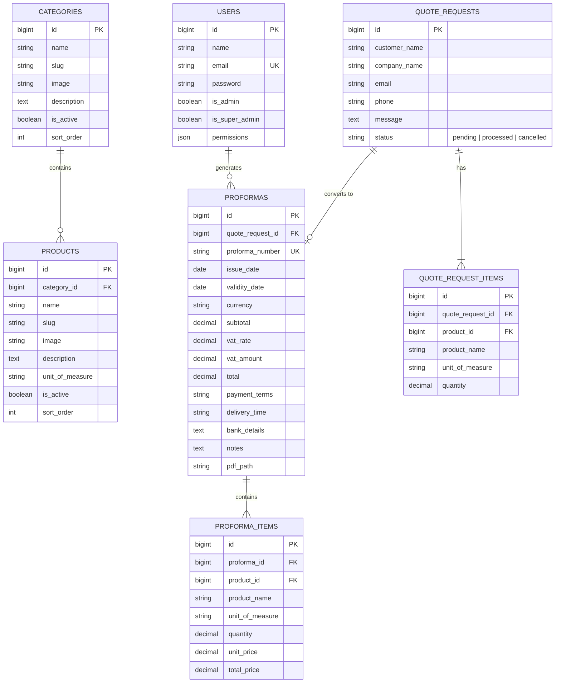

# Coopera Trading Platform

[](https://laravel.com)
[](https://php.net)
[](https://tailwindcss.com)
[](https://alpinejs.dev)
[](https://www.docker.com)

A modern, enterprise-grade B2B e-commerce and trading website built for **Coopera Trading** — a premier multi-sector trading enterprise supplying construction chemicals, industrial supplies, water treatment equipment, packaging, technology, and export commodities across Ethiopia and global markets.

This platform provides a high-converting public catalog, an interactive quote request engine with real-time product search, an administrative CMS with granular team permissions, and an automated VAT-compliant PDF Proforma Invoice generator that emails official invoices directly to clients.

---

## Table of Contents

1. [Key Features](#-key-features)
2. [Technology Stack](#-technology-stack)
3. [Repository Structure](#-repository-structure)
4. [Quick Start (Local Development)](#-quick-start-local-development)
   - [Method A: Docker (Recommended - Zero Host Dependencies)](#method-a-docker-recommended---zero-host-dependencies)
   - [Method B: Native Host Environment](#method-b-native-host-environment)
5. [Default Access & Credentials](#-default-access--credentials)
6. [Route Map & URLs](#-route-map--urls)
7. [Core Workflows](#-core-workflows)
   - [1. Quote Request Submission](#1-quote-request-submission)
   - [2. Proforma Invoice Generation & PDF](#2-proforma-invoice-generation--pdf)
   - [3. Proforma Templates & Terms](#3-proforma-templates--terms)
   - [4. Role & Permission Management](#4-role--permission-management)
8. [Database Architecture & Schema](#-database-architecture--schema)
9. [Configuration & Environment Variables](#-configuration--environment-variables)
10. [Production Deployment](#-production-deployment)
    - [Zero-Terminal cPanel Deployment (ZIP Method)](#zero-terminal-cpanel-deployment-zip-method)
    - [SSH / Git-Based Deployment](#ssh--git-based-deployment)
11. [Maintenance & Helper Scripts](#-maintenance--helper-scripts)
12. [Troubleshooting & FAQ](#-troubleshooting--faq)

---

## 🌟 Key Features

### Public Frontend
- **Modern Industrial B2B Aesthetic**: Clean, responsive design featuring custom typography, golden amber branding accents, hero image carousels, and trusted partner showcases.
- **Product Catalog by Sector**: Categorized view across 6 major sectors:
  1. *Construction Product Markets* (Concrete solutions, waterproofing, sealants, repair, flooring, roofing)
  2. *Industrial Chemicals* (Plasticizers, PVC resins, stabilizers, solvents, fillers)
  3. *Water & Environmental Solutions* (Treatment chemicals, equipment, filtration, pumps)
  4. *Packaging & Industrial Supplies* (Films, containers, consumables, PPE)
  5. *Industrial Technology Solutions* (Automation, instrumentation, power systems, smart infrastructure)
  6. *Export Products* (Grade-1 Ethiopian Coffee, sesame, oilseeds, pulses, spices)
- **Interactive Quote Request Engine**: Alpine.js-powered multi-product selector with live catalog search, unit of measure awareness, dynamic row additions, and quantity calculations.
- **Header Live Search API**: Instant debounced product lookup (`/api/products/search`) returning matching products, categories, and direct links.
- **Digital Proforma Verification**: Public online verification portal (`/verify/proforma/{number}`) allowing customers or customs authorities to verify issued proforma invoices via QR code or direct link.
- **Contact & Inquiries**: Validated corporate contact form dispatching notifications to company management.

### Administrative Panel (`/admin`)
- **Dashboard Overview**: Summary of quote requests, pending proformas, recent inquiries, active catalog items, and system health.
- **Catalog Management**: Full CRUD for Categories and Products, image uploads to storage, active/inactive toggles, and custom sort ordering.
- **Hero Slider & Partner Brand Management**: Reorderable homepage carousel slides with call-to-actions, plus partner/client logo grids.
- **Sales & Proforma Processing**:
  - Review submitted quote requests with customer contact info and line items.
  - Convert any quote request into an official proforma invoice with 1 click.
  - Automatically calculates subtotal, 15% VAT (configurable), and grand totals in ETB or USD.
  - Auto-generates sequential proforma numbers (`PROF-YYYYMMDD-XXXX`) and 30-day validity windows.
  - Inputs payment terms, delivery schedules, bank details, and custom notes.
- **Automated PDF Engine & Emailer**:
  - Uses `barryvdh/laravel-dompdf` to render pixel-perfect, printable A4 PDF invoices with Coopera corporate branding, bank details, and stamp/signature blocks.
  - Automatically emails the customer with the PDF attached using Laravel Mail.
  - Download or stream PDF directly from the admin interface.
- **Customizable Proforma Templates**: Manage default payment terms, validity periods, bank account numbers (CBE, Awash, etc.), and legal notes without touching code.
- **Team & Permissions Control**: Manage staff accounts with fine-grained access switches for `categories`, `products`, `partners`, `hero-slides`, `quotes`, `templates`, and `users`.

---

## 🛠 Technology Stack

| Layer | Technology | Description |
|---|---|---|
| **Backend** | [Laravel 11](https://laravel.com) | PHP 8.2+ framework with Eloquent ORM, Service Providers, and Blade engine |
| **Frontend** | [Tailwind CSS 3](https://tailwindcss.com) + [Alpine.js 3](https://alpinejs.dev) | Modern utility styling with lightweight reactive JavaScript |
| **Asset Bundler** | [Vite 6](https://vitejs.dev) | Fast ESM asset bundler with Tailwind JIT compilation |
| **Database** | SQLite (dev) / MySQL 8.0 (prod) | Zero-configuration local storage or scalable production relational database |
| **PDF Generation**| [barryvdh/laravel-dompdf](https://github.com/barryvdh/laravel-dompdf) | Server-side PDF rendering from Blade templates |
| **Authentication**| [Laravel Breeze](https://laravel.com/docs/starter-kits#laravel-breeze) | Secure session authentication with extended role/permission gates |
| **Containerization**| [Docker](https://docker.com) | Alpine-based PHP 8.5 image with `gd`, `pdo_mysql`, `bcmath`, `mysqli` extensions |

---

## 📁 Repository Structure

```
coopera/
├── PRD.md                       # Original Product Requirements Document
├── README.md                    # Root project documentation (this file)
├── proforma-preview.pdf         # Sample generated proforma invoice PDF
└── cooperatrading/              # Main Laravel Application
    ├── app/
    │   ├── Http/
    │   │   ├── Controllers/
    │   │   │   ├── Admin/       # Category, Product, Partner, HeroSlide, Proforma, Quote, User
    │   │   │   ├── Api/         # ProductSearchController (live search)
    │   │   │   ├── Auth/        # Breeze authentication controllers
    │   │   │   ├── ContactController.php
    │   │   │   ├── HomeController.php
    │   │   │   ├── ProductCatalogController.php
    │   │   │   └── QuoteRequestController.php
    │   │   └── Middleware/      # EnsureUserIsAdmin, EnsureUserHasPermission
    │   ├── Mail/                # ContactFormSubmission.php, ProformaSent.php
    │   ├── Models/              # Category, Product, Partner, HeroSlide, QuoteRequest, Proforma, User
    │   └── View/Composers/      # View composers for shared navigation data
    ├── bootstrap/               # App bootstrap & providers
    ├── config/                  # App, database, mail, dompdf configuration
    ├── database/
    │   ├── database.sqlite      # SQLite database file
    │   ├── migrations/          # 15 schema migrations
    │   ├── mysql_coopera_dump.sql # Complete pre-seeded MySQL dump for production
    │   └── seeders/             # AdminUserSeeder, CategoryProductSeeder, HeroSlideSeeder, PartnerSeeder
    ├── docker/                  # Dockerfile for custom PHP environment
    ├── public/                  # Document root
    │   ├── assets/              # Brand vectors, logos, and static imagery
    │   ├── build/               # Compiled Vite production assets
    │   ├── clear-cache.php      # Zero-terminal cache cleaner & migration helper
    │   ├── debug.php            # Environment and database diagnostic tool
    │   └── storage/             # Symlink to storage/app/public
    ├── resources/
    │   ├── css/ & js/           # Tailwind CSS styles and Alpine.js scripts
    │   └── views/
    │       ├── admin/           # Admin panel management views
    │       ├── auth/            # Login, password reset, and registration
    │       ├── emails/          # HTML/plain email notification templates
    │       ├── layouts/         # app.blade.php, admin.blade.php, navigation.blade.php
    │       ├── pdf/             # dompdf proforma invoice Blade template
    │       └── products/ & quote/ # Public catalog and quote form views
    ├── routes/
    │   ├── auth.php             # Authentication routes
    │   ├── console.php          # Artisan console commands
    │   └── web.php              # Public, admin, and utility web routes
    ├── scripts/                 # Deployment zip & MySQL dump packaging scripts
    ├── storage/                 # Logs, sessions, uploaded products, and generated PDFs
    ├── artisan-container.sh     # Docker wrapper for running artisan & composer
    ├── composer.json            # PHP dependencies
    ├── package.json             # NPM dependencies (Tailwind, Alpine, Vite)
    └── vite.config.js           # Vite configuration
```

---

## 🚀 Quick Start (Local Development)

### Method A: Docker (Recommended - Zero Host Dependencies)

You do **not** need PHP or Composer installed on your host machine. Docker will manage the runtime.

#### 1. Start the Application Container
From the repository root or inside `cooperatrading/`:
```bash
cd cooperatrading

# Run the container in the background
docker run -d \
  --name coopera-app \
  --restart unless-stopped \
  -p 8000:8000 \
  -v $(pwd):/app \
  -w /app \
  -e HOME=/tmp \
  cooperatrading-php:latest \
  php artisan serve --host=0.0.0.0 --port=8000
```

> **Note:** If the Docker image `cooperatrading-php:latest` is not built yet, build it with:
> ```bash
> docker build -t cooperatrading-php docker/
> ```

#### 2. Install Dependencies & Build Frontend
```bash
# Frontend assets
npm install
npm run build
```

#### 3. Run Database Migrations & Seeds
Using the included `artisan-container.sh` helper:
```bash
./artisan-container.sh php artisan migrate --seed
./artisan-container.sh php artisan storage:link
```

#### 4. Access the Website
Open your browser and navigate to:
- **Public Site:** [http://localhost:8000](http://localhost:8000)
- **Admin Panel:** [http://localhost:8000/admin](http://localhost:8000/admin)

---

### Method B: Native Host Environment

If you have PHP 8.2+ and Composer installed locally on your system:

#### 1. Check PHP Extensions
Ensure the following PHP modules are enabled:
`php-pdo`, `php-sqlite3` (or `php-mysql`), `php-gd`, `php-bcmath`, `php-curl`, `php-mbstring`, `php-xml`.

#### 2. Install & Configure
```bash
cd cooperatrading

# Install PHP dependencies
composer install

# Environment configuration
cp .env.example .env
php artisan key:generate

# Build frontend
npm install
npm run build

# Database & storage link
touch database/database.sqlite
php artisan migrate --seed
php artisan storage:link

# Start development server
php artisan serve
```

---

## 🔐 Default Access & Credentials

The database is pre-seeded with an active Super Administrator account:

| Role | Email | Password | Permissions |
|---|---|---|---|
| **Super Admin** | `tsedey.yayeh@cooperatrading.com` | `P@ssw0rdcoop2026` | Full Access (All modules) |

> ⚠️ **Security Tip:** In a live production environment, log in and change your password immediately under `/profile`.

---

## 🗺 Route Map & URLs

### Public Endpoints
| URL | Method | Purpose |
|---|---|---|
| `/` | `GET` | Homepage with hero slider, featured sectors, advantages, and partners |
| `/about` | `GET` | Company background, mission, vision, and core values |
| `/products` | `GET` | Comprehensive product catalog browsing all 6 market sectors |
| `/products/{category}` | `GET` | Products within a specific category |
| `/products/{category}/{product}` | `GET` | Detailed product specifications and direct "Add to Quote" action |
| `/quote` | `GET`, `POST` | Interactive multi-product quote request submission form |
| `/quote/thank-you` | `GET` | Confirmation page following successful quote submission |
| `/contact` | `GET`, `POST` | Contact info, office location, and direct message form |
| `/verify/proforma/{number}` | `GET` | Public proforma invoice digital authenticity verification |
| `/api/products/search` | `GET` | Debounced JSON search API for header search bar |

### Administrative Endpoints (`/admin` prefix - Auth Required)
| URL | Controller | Description |
|---|---|---|
| `/admin` | `DashboardController` | Overview metrics, quick actions, and recent activity |
| `/admin/quote-requests` | `QuoteRequestController` | Incoming customer quote requests table |
| `/admin/quote-requests/{id}` | `QuoteRequestController` | Inspection of customer inquiry and requested items |
| `/admin/proformas/create/{quoteId}` | `ProformaController` | Pricing editor and proforma invoice generator |
| `/admin/proformas/{id}` | `ProformaController` | View generated proforma with VAT and details |
| `/admin/proformas/{id}/download` | `ProformaController` | Download generated A4 PDF invoice |
| `/admin/proformas/{id}/stream` | `ProformaController` | Stream PDF directly in browser |
| `/admin/categories` | `CategoryController` | Category CRUD, status toggling, and image uploads |
| `/admin/products` | `ProductController` | Product CRUD, image uploads, category assignment, UoM |
| `/admin/partners` | `PartnerController` | Partner brand logos and website links |
| `/admin/hero-slides` | `HeroSlideController` | Homepage hero carousel slide editor and reordering |
| `/admin/proforma-templates`| `ProformaTemplateController`| Default terms, bank accounts, and notes configuration |
| `/admin/users` | `AdminUserController` | Team management and granular permission assignments |

---

## 🔄 Core Workflows

### 1. Quote Request Submission
1. Customer visits `/quote` or clicks **Request a Quote** from any product page.
2. The customer enters their name, company name, email, phone number, and optional project requirements.
3. Using the Alpine.js selector, the customer searches and selects products from the catalog, inputting the needed quantity and unit of measure.
4. On submission, records are inserted into `quote_requests` (status: `pending`) and `quote_request_items`.
5. An email notification is logged or sent to the Coopera sales team.

### 2. Proforma Invoice Generation & PDF
1. The sales administrator navigates to `/admin/quote-requests` and opens the customer request.
2. The admin clicks **"Create Proforma Invoice"**.
3. The system pre-fills the customer's selected items and allows the admin to:
   - Set the **Unit Price** for each item.
   - Adjust quantities or remove/add items.
   - Review auto-calculated **Subtotal**, **15% VAT**, and **Grand Total**.
   - Select or customize **Payment Terms** (e.g., 100% advance, 30% advance / 70% before dispatch).
   - Enter **Delivery Timeline** (e.g., Immediate ex-stock, 10–15 business days).
   - Specify **Bank Details** (Commercial Bank of Ethiopia, Awash Bank, etc.).
4. When the admin clicks **"Save & Send Proforma"**:
   - A sequential invoice number is assigned (e.g., `PROF-20261014-0012`).
   - The invoice validity date is set (default: 30 days).
   - DomPDF compiles the invoice into an official A4 document with corporate branding and verification link.
   - The PDF is saved to `storage/app/proformas/` and automatically sent to the customer via `ProformaSent` Mailable.
   - The quote request status updates to `processed`.

### 3. Proforma Templates & Terms
Administrators can configure the company's default proforma terms at `/admin/proforma-templates`:
- Default delivery timeline
- Default payment conditions
- Bank account details (Account Name, Bank Name, Account Number, Swift Code)
- Standard legal disclaimers and quotation notes

### 4. Role & Permission Management
The system includes granular team security. Inside `/admin/users`, admins can toggle individual permissions:
- `categories`: Manage catalog categories
- `products`: Manage product listings
- `partners`: Manage homepage partner logos
- `hero-slides`: Manage homepage slider
- `quotes`: Process quotes and issue proforma invoices
- `templates`: Edit company-wide proforma terms & bank details
- `users`: Add or remove staff members and change roles

---

## 🗄 Database Architecture & Schema

The database utilizes Eloquent ORM relationships with the following primary entities:



---

## ⚙️ Configuration & Environment Variables

Key parameters in `cooperatrading/.env`:

```ini
# Application Configuration
APP_NAME="Coopera Trading"
APP_ENV=local                       # Change to 'production' for live server
APP_KEY=base64:...                  # Generate via 'php artisan key:generate'
APP_DEBUG=true                      # Set to 'false' in production
APP_URL=http://localhost:8000       # e.g. https://cooperatrading.com

# Regional & Financial Defaults
APP_TIMEZONE=Africa/Addis_Ababa
APP_CURRENCY=ETB
APP_CURRENCY_SYMBOL=Br
APP_VAT_RATE=15

# Database - SQLite (Local / Zero-Setup)
DB_CONNECTION=sqlite

# Database - MySQL (Production / cPanel)
# DB_CONNECTION=mysql
# DB_HOST=localhost
# DB_PORT=3306
# DB_DATABASE=cooperat_db
# DB_USERNAME=cooperat_user
# DB_PASSWORD="YourSecurePassword"

# Email Configuration (cPanel SMTP)
MAIL_MAILER=smtp
MAIL_HOST=mail.cooperatrading.com
MAIL_PORT=587
MAIL_USERNAME=info@cooperatrading.com
MAIL_PASSWORD=your_email_password
MAIL_ENCRYPTION=tls
MAIL_FROM_ADDRESS="info@cooperatrading.com"
MAIL_FROM_NAME="Coopera Trading"
ADMIN_EMAIL=info@cooperatrading.com
```

---

## 🚢 Production Deployment

### Zero-Terminal cPanel Deployment (ZIP Method)

For standard cPanel / shared hosting (e.g. Namecheap, Yegar) without SSH terminal access:

1. **Locate or Build the Production Package:**
   The repository includes a self-contained deployment bundle:
   `cooperatrading/coopera-deployment-latest.zip`

   To regenerate the bundle locally:
   ```bash
   python3 cooperatrading/scripts/build_deployment_zip.py
   ```

2. **Upload & Extract:**
   - Log in to your cPanel File Manager.
   - Upload `coopera-deployment-latest.zip` to your target directory (e.g., `public_html/`).
   - Extract the zip archive.
   - Delete the zip file after extraction.

3. **Routing & Document Root:**
   - If cPanel allows setting the Document Root, set it to `/public`.
   - If using root `public_html/`, the included root `.htaccess` will automatically rewrite all incoming traffic to `/public` seamlessly.

4. **Database Selection:**
   - **SQLite (Instant Launch):** Pre-seeded and active by default. No setup needed.
   - **MySQL (phpMyAdmin):** Create a database in cPanel, import `database/mysql_coopera_dump.sql`, and update credentials in `.env`.

5. **One-Click Maintenance URLs:**
   Visit these endpoints once in your web browser:
   - `https://your-domain.com/clear-cache.php` — Clears cached config/routes, checks migrations, and creates storage symlinks.
   - `https://your-domain.com/debug.php` — Verifies PHP runtime, modules, and database connectivity.

---

### SSH / Git-Based Deployment

For VPS, Cloud, or SSH-enabled servers:

```bash
# 1. Clone repository
git clone https://github.com/CooperaTrading/coopera.git /var/www/coopera
cd /var/www/coopera/cooperatrading

# 2. Production dependencies
composer install --no-dev --optimize-autoloader
npm install && npm run build

# 3. Environment configuration
cp .env.production .env
php artisan key:generate

# 4. Migrate and seed
php artisan migrate --force --seed

# 5. Optimize & link storage
php artisan storage:link
php artisan config:cache
php artisan route:cache
php artisan view:cache
```

---

## 🧰 Maintenance & Helper Scripts

All commands should be executed from within `cooperatrading/`:

| Command / Script | Purpose |
|---|---|
| `./artisan-container.sh php artisan <command>` | Runs any Artisan command inside the Docker environment |
| `./artisan-container.sh composer <command>` | Runs Composer commands inside the Docker environment |
| `npm run dev` | Starts the Vite hot-module replacement server on port `5174` |
| `npm run build` | Compiles and minifies production assets into `public/build/` |
| `python3 scripts/build_deployment_zip.py` | Compiles a production-ready zero-terminal cPanel deployment ZIP |
| `python3 scripts/dump_mysql.py` | Exports current database state into `database/mysql_coopera_dump.sql` |
| `php artisan cache:clear && php artisan view:clear` | Purges application cache and re-compiles Blade views |

---

## ❓ Troubleshooting & FAQ

#### 1. Why do uploaded product images not display?
Ensure the public storage symlink exists:
```bash
./artisan-container.sh php artisan storage:link
```
Also verify file permissions on `storage/` and `bootstrap/cache/`:
```bash
chmod -R 775 storage bootstrap/cache
```

#### 2. How to restart the Docker development server?
If the container stops or needs a refresh:
```bash
docker rm -f coopera-app
docker run -d --name coopera-app --restart unless-stopped -p 8000:8000 \
  -v $(pwd):/app -w /app -e HOME=/tmp cooperatrading-php:latest \
  php artisan serve --host=0.0.0.0 --port=8000
```

#### 3. Where do emails go during local development?
When `MAIL_MAILER=log` is set in `.env`, outgoing emails are not sent over the internet. Instead, full email contents and headers are logged to:
`cooperatrading/storage/logs/laravel.log`.

---

## 📄 License & Rights

Proprietary Software. Copyright © 2026 Coopera Trading. All rights reserved.
Developed for official commercial operations of Coopera Trading.
